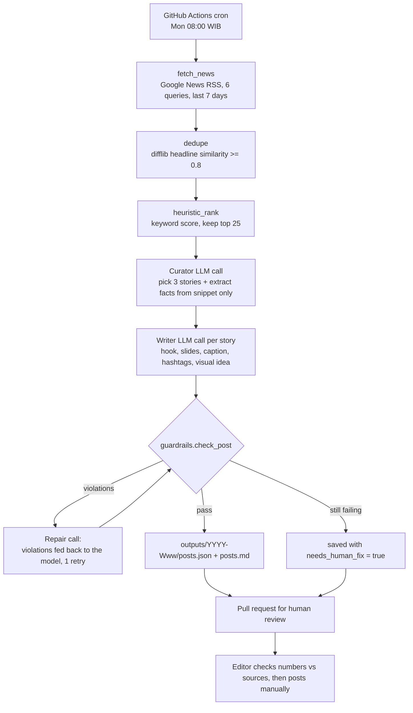

# Architecture

## Why it is built this way

| Decision | Reason |
|---|---|
| Two LLM stages (curate, then write) | Story choice and copywriting need different instructions. Curation also extracts the *only* facts the writer may use. |
| Facts are extracted before writing | Lets the guardrail verify that every number in the post exists in the facts list. |
| Guardrails are plain Python | A model can forget a rule; a regex does not. Brand rules are enforced after generation, not just requested. |
| One repair attempt, then flag | Feeding the exact violations back usually fixes them; if not, a human sees a clear "needs fix" label instead of a silently bad post. |
| Output is a pull request | A property brand should not auto-post unreviewed statistics. |
| Offline `--fixture` mode | Lets anyone run and test the pipeline without network access or an API key. |
